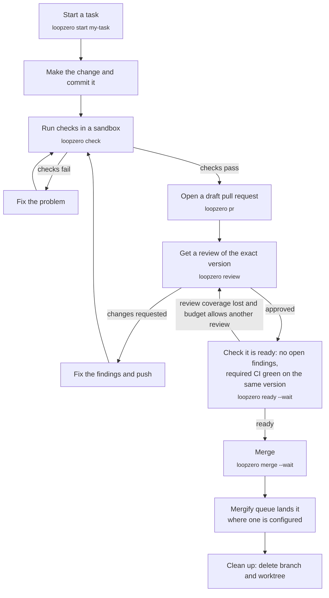
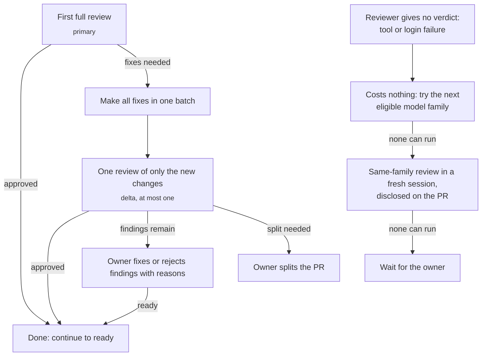
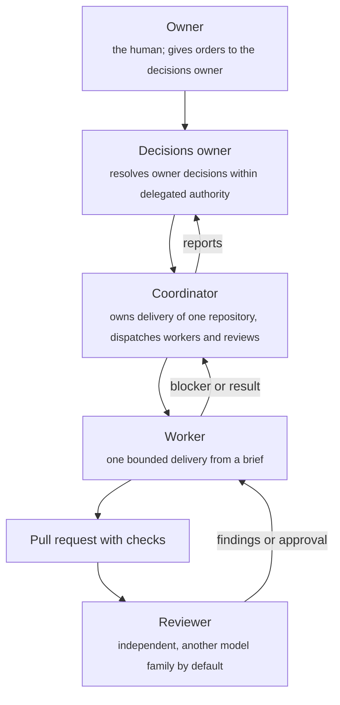

# Workflow at a glance

Plain-language pictures of how a change moves through loop-zero. They summarize
the rules; when a picture and the rules disagree, the rules win. Commands are
shown in small text beside each step.

## 1. From idea to merged

Summarizes [The six steps](../core/CONTRACT.md#the-six-steps),
[Blockers](../core/CONTRACT.md#blockers) (review coverage, head movement and
readiness) and the [review budget](../core/CONTRACT.md#review-budget); the queue
is described in [MERGIFY.md](MERGIFY.md).

## 2. How many reviews a change gets

See the contract's [review budget](../core/CONTRACT.md#review-budget).

## 3. Who does what

Each role has one current owner, and state lives in Git and GitHub rather than
in anyone's memory.

Summarizes [Team roles](DELEGATION.md#team-roles) and
[Review budget](../core/CONTRACT.md#review-budget).
