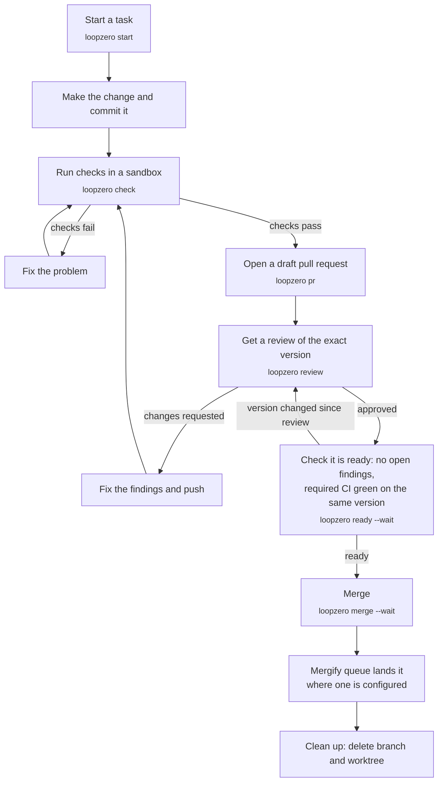
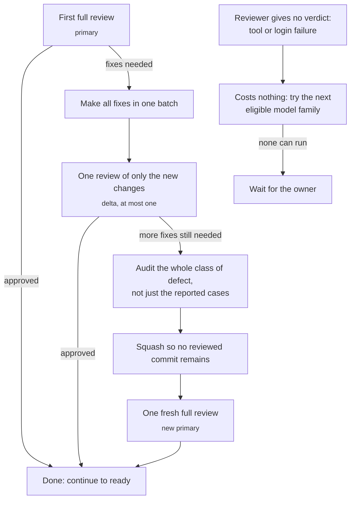
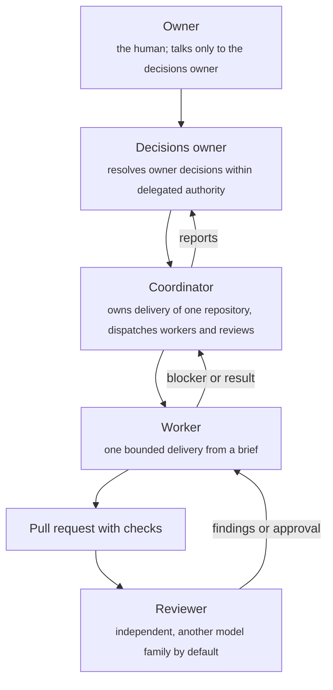

# Workflow at a glance

Plain-language pictures of how a change moves through loop-zero. They summarize
the rules; when a picture and the rules disagree, the rules win. Commands are
shown in small text beside each step.

## 1. From idea to merged

The review and the CI results belong to one exact version (head) of the
branch. If the branch changes after the review, that review no longer counts
and the change is reviewed again. Work stops at "ready" unless merging has been
authorized.

Summarizes [The six steps](../core/CONTRACT.md#the-six-steps) and
[Blockers](../core/CONTRACT.md#blockers); the queue is described in
[MERGIFY.md](MERGIFY.md).

## 2. How many reviews a change gets

Each line of work gets one full review and at most one follow-up that reads
only what changed. The reviewer comes from a model family that did not write
any part of the change. A failed reviewer run that
produced no verdict does not use up a review; if no eligible reviewer can run
at all, wait for the owner. Repeated findings of the same kind mean the audit
missed something, not that patching should continue.

Summarizes [Review budget](../core/CONTRACT.md#review-budget).

## 3. Who does what

Each role has one current owner, and state lives in Git and GitHub rather than
in anyone's memory. A worker that is stuck sends one message with its blocker
to its parent and stops instead of asking a person directly.

Summarizes [Team roles](DELEGATION.md#team-roles) and
[Review budget](../core/CONTRACT.md#review-budget).
